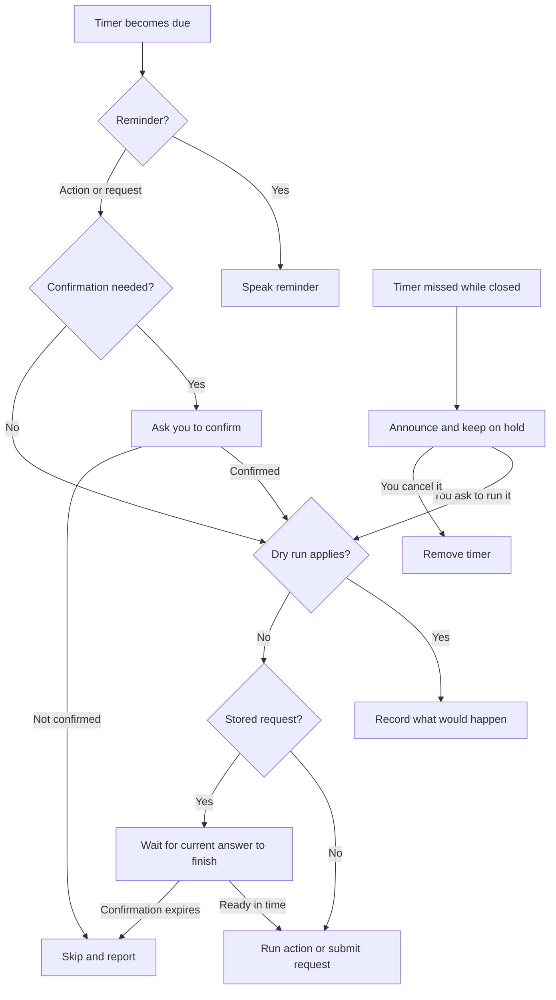

# Wingman Enhanced Timers

Voice alarms, reminders and scheduled assistant requests for Wingman AI. Timers survive a Wingman restart. No Wingman Core changes or separate service.

## What you can say

- “In ten minutes, remind me to check the refinery.”
- “At 8 PM, remind me to leave.”
- “At 8 PM Pacific time, remind me to join the crew.”
- “What time is it here?” / “What time is it in Tokyo?”
- “Every fifteen minutes, remind me to check my fuel.”
- “In five minutes, ask the assistant to give me a one-sentence preflight checklist.”
- “List my timers.” / “Cancel the refinery timer.”

A reminder speaks directly. A scheduled assistant request asks for confirmation when due, then waits for Wingman to finish the current answer before submitting the request. That assistant uses its normal model, tools and action controls. Submission does not mean its task succeeded.

**Enhanced Timers works with ordinary Wingman.** Reminders, alarms and scheduled
assistant replies need no other skill.

You can also schedule a tool your assistant already has. With Wailing Wilma
enabled, try “In five minutes, ask Wilma for her current engineering status.”
This reports the latest readings Wilma already has. A timed quantum-fuel check
requires a tool that can read current fuel.

Timers missed while Wingman was closed are announced and listed; they never run silently on startup. Ask to run or cancel one.

## Install

Requires Wingman AI 3.2.14 or later and its public v3 skills API. Wingman already supplies the `httpx` dependency used for its local API.

1. Download the skill ZIP from [Releases](https://github.com/Fowlplaychiken/wingman-enhanced-timers/releases).
2. Fully quit Wingman. Extract the `enhanced_timers` folder into `%APPDATA%\ShipBit\WingmanAI\custom_skills`.
3. Reopen Wingman. For your chosen assistant, disable the stock **Timer** and enable **Enhanced Timers**. Use only one: they share timer tool names.
4. Try a short reminder, then ask to list your timers.

Existing stock timers cannot be imported because stock Wingman holds them only in memory. Finish or cancel those before switching. Keep the prior skill version for rollback.

## When a timer acts

Reminders run when due. Commands that contain input, unfamiliar action tools and stored requests ask you to say **“confirm timer”** first. If several await confirmation, name the timer. The confirmation window defaults to 60 seconds; queued speech can reduce the time available, so ask for timer status if unsure. Unconfirmed timers are skipped and reported.

A confirmed stored request waits in a short queue while Wingman is answering. The existing confirmation window also covers that wait. You can cancel the queued request; if the window expires, it is skipped and reported. After a restart, it stays on hold until you ask to run it again.

A cancelled timer cannot be started from a stale worker snapshot. An action that has already begun may have an uncertain outcome; the skill does not automatically repeat it. A scheduled tool cannot confirm another timer or run a missed timer on your behalf.

Turn on **Dry run actions** to check a timer before letting it act. Set a short action or request timer, confirm it when asked, then say “show my dry-run log” to see what would have happened. Stored requests and actions requiring confirmation are recorded instead of run. Reminders and reviewed read-only tools still run.

To test scheduling and confirmation, turn on dry run and schedule the preflight
checklist above. Confirm when prompted, then ask for the dry-run log. No video
or game is needed. Testing how an optional skill reads a gameplay video
requires that skill's own test setup.



## Settings

| Setting | Default | Use |
|---|---|---|
| Timer file | automatic | Private JSON file scoped to your assistant name; optional explicit path. Keep private: it contains reminder/request text. |
| Tools allowed without confirmation | See skill settings | Add exact names of harmless read-only tools already available to your assistant. A name in this list does not install a tool. Other tools and input commands ask first. |
| Ask before stored requests | on | Confirmation before submitting a full assistant turn. |
| Core API port | `49111` | Change only if your Wingman uses another local port. Fixed loopback only; no external server. |
| Confirm window | 60 seconds | Time to confirm a due action. |
| Check interval | 2 seconds | How often timers are checked. |
| Dry run actions | off | Record stored requests and actions requiring confirmation instead of running them. |

Different assistant names get separate saved files. If you use the same assistant name in multiple profiles, set a distinct **Timer file** for each; the public skill API does not expose profile identity. The old unscoped `timers.json` is kept untouched; choose it explicitly only if you intend to reuse it.

Clock times use the timezone on the PC running Wingman. If you name another timezone, the skill uses that timezone for the request. “Noon” and “midnight” work. A clock time already passed in the selected timezone means tomorrow. The skill reports the resolved time and asks you to disambiguate a clock time that occurs twice when clocks change. Repeating clock-time alarms use a fixed 24-hour interval, so they can shift by an hour at a daylight-saving change.

## Diagnostics and limits

Ask to list timers to see pending, missed, awaiting-confirmation and confirmed-but-waiting states. Errors go to Wingman's skill log. Corrupt or unsupported timer data is retained as a `.bad` file and reported; no actions are inferred from it. Scheduled requests use the original local Core API, check the active profile, and are submitted once. A timeout after submission is reported as unknown and is not retried.

Offline tests cover persistence across separate Python processes, cancellation, confirmation, dry runs, worker shutdown and local API submission. In Wingman, a confirmed scheduled assistant request completed. A pending reminder survived a profile reload, and a separate text-created reminder survived a full app restart and fired once when due. Microphone input and gameplay were outside these checks.

## Development

Python 3.11 or later. Install test dependencies in your development environment, then run:

```sh
python -m pytest -q
ruff check .
python build.py --out /path/to/new/output-folder
```

The ZIP includes the skill and the pinned [Python tzdata 2026.6 wheel](https://pypi.org/project/tzdata/2026.6/) for systems without IANA timezone data. It reads the bundled data directly, so users need no dependency install. The wheel includes its upstream license. Tests mock Wingman and HTTP calls.

Based on the stock [Wingman Timer](https://github.com/ShipBit/wingman-ai/tree/main/skills/timer), under MIT. This optional module is independently maintained and does not modify Wingman Core.
